 

<!-- Animated contribution graph: real GitHub contribution data.
     The boxes reveal cell by cell.
     Auto-refreshed daily by .github/workflows/update-profile-art.yml. -->
<h3><code>sunny@github ~ $ ./contributions.sh</code></h3>

  
 
 
---
<!-- ASCII portrait (left) + contribution stats card (right).
     Both SVGs are designed to have matching dimensions.
     Portrait: prepare your photo with scripts/prep_photo.py,
     then generate the SVG with scripts/make_ascii_svg.py.
     Stats: generated by scripts/render_stats_svg.py.
     Both can be regenerated by the profile art workflow. -->
<h3><code>sunny@github ~ $ whoami</code></h3>

<table>
<tr>
<td valign="top">

</td>
<td valign="top">

</td>
</tr>
</table>

  
 
 
---
<!-- 

  <h3><code>sunny@github ~ $ about-me</code></h3>

  

---
-->

  <h3><code>sunny@github ~ $ tech-stack</code></h3>

---

<!-- 

  <h3><code>sunny@github ~ $ github-stats</code></h3>

  

  

 

  

---
-->

<!-- 

  <h3><code>sunny@github ~ $ activity.log</code></h3>

  

---
-->

<!--
##  Contribution Snake

---
-->

<!--

  <h3><code>sunny@github ~ $ connect.sh</code></h3>

&nbsp;

&nbsp;

&nbsp;

&nbsp;

&nbsp;

&nbsp;

&nbsp;

---
-->

<!-- Personal links and developer introduction. -->
<h3><code>sunny@github ~ $ ./links.sh</code></h3>

<b>Software Engineer · Full-Stack Developer · Problem Solver</b>

 

---

  <h3><code>sunny@github ~ $ contact --me</code></h3>

*Always open to meaningful collaborations, great projects, and open-source opportunities.*
 
*Built with intent. Shipped with purpose.*

  
    &nbsp;&nbsp;&nbsp;
  

